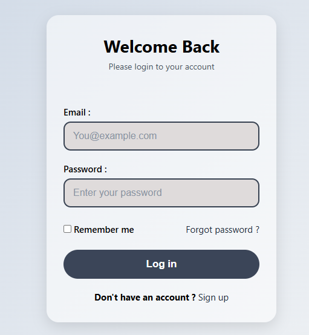
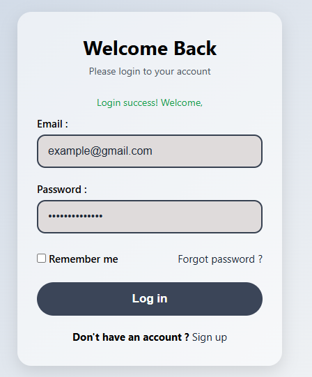
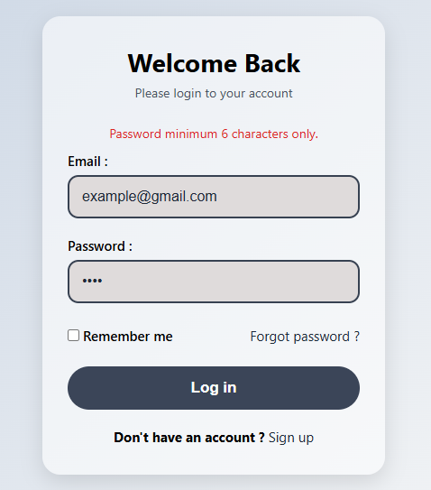

# Login Page

A simple and responsive login page built with HTML, CSS, and JavaScript.

     

## Features

- Clean and simple design
- Fully responsive (works on mobile, tablet, and desktop)
- Email and password fields
- "Remember me" checkbox
- "Forgot password" and "Sign up" links
- Basic password check (minimum 6 characters)
- Success and error messages

## Technologies Used

- HTML5
- CSS3 (Flexbox, Media Queries)
- JavaScript 

## How to Run

1. Download or clone this project.
2. Open the `form.html` file in any web browser.

You can also use the Live Preview or Live Server extension in VS Code.

## How It Works

- Enter your email and password, then click **Log in**.
- If the password has less than 6 characters, an error message is shown.
- If the password has 6 or more characters, a success message is shown.

## Note

This is a demo project. The login check is only done in the browser, so it does not connect to a real server or database. For a real project, you should verify the user on the backend.
